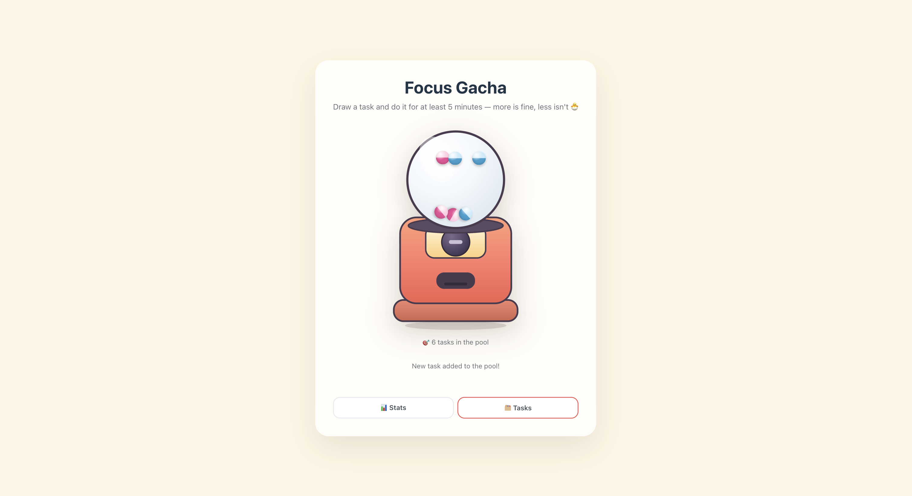

# Focus Gacha 🎰

**Live demo: [focus-gacha.vercel.app](https://focus-gacha.vercel.app/)**

A task randomizer that turns "what should I work on?" into pulling a handle on a gashapon (capsule toy) machine, instead of staring at a to-do list.

Built as a lightweight, judgment-free way to get moving on a task when deciding *what* to do next feels harder than actually doing it.



## The idea

It's a to-do list, but with two twists:

**Tasks are split into two kinds, and both are welcome.** Blue capsules are "need to do" — the tedious-but-necessary stuff. Pink capsules are "want to do" — things you'd actually enjoy, like gaming or watching TV. Most to-do apps only track obligations; this one treats "things you want to do anyway" as legitimate entries in the same pool, so the machine isn't just a chore dispenser. Each task also gets a 1–5 star priority when you add it.

**The draw is the commitment.** When you pull the handle, the machine picks one task at random and expects you to start it right away — no re-rolling because you don't feel like it. If a task genuinely isn't doable right now, **Skip for today** pulls it out of the pool so it won't come up again until you re-add it, and you draw again. There's no "try again" button, on purpose — the randomness is what removes the decision paralysis.

**The 5-minute timer is a starting nudge, not a limit.** Once you draw, you start a 5-minute countdown. It's there to get you past the "starting is the hardest part" wall, not to cap your effort — when it hits zero, it doesn't stop; it flips into an "overtime" stopwatch that keeps counting for as long as you keep going. And the **Done** button is gated on that first 5 minutes actually finishing — click it before the countdown reaches zero and it'll tell you to go finish the 5 minutes first rather than quietly letting a task count as complete. If you truly can't stick with it, that's what Skip is for.

## Features

- **Gacha machine, built as SVG + real physics** — the machine body is a hand-drawn vector illustration; the capsules inside are simulated with a from-scratch 2D physics loop (gravity, wall/collision bouncing, rest detection) so they fall and settle in a pile like real capsules in a glass dome, not a canned animation
- **5-minute commitment timer with completion gating** — countdown with an audio chime, then an open-ended "overtime" stopwatch; marking a task done is blocked until the initial 5 minutes have actually elapsed
- **Task pool management** — add tasks with a name, a want/need type, and a 1–5 star priority; delete permanently or skip for today
- **Stats & achievements** — a Today/All-time toggle on draws, completions, completion rate, and focus time, plus lifetime unlockable achievement milestones and a one-click (confirmed) reset if you want to start fresh
- **Task history log** — a running record of what you drew, when, and how it ended (completed / skipped / abandoned)
- **Persistent locally** — task pool and stats are saved to `localStorage`, so your data survives a refresh

## Tech stack

- [React 19](https://react.dev/) + [Vite 7](https://vite.dev/)
- Plain CSS (no UI framework) — hand-built SVG machine illustration, capsule physics, and a single responsive layout
- Web Audio API for the timer's notification sound
- ESLint with the React Hooks plugin
- Deployed on [Vercel](https://vercel.com/) (static build, auto-deploys on push to `main`)

## Running it locally

```bash
npm install
npm run dev
```

Then open the printed local URL (defaults to `http://localhost:5173`).

Other scripts:

```bash
npm run build    # production build
npm run preview  # preview the production build locally
npm run lint      # lint the codebase
```

## How it works

1. Open the **Tasks** tab and add a few things to the pool — mix "need to do" chores with "want to do" fun stuff, and set a star priority for each.
2. Pull the handle on the machine to draw a random task, and start on it right away.
3. Start the 5-minute timer. Once it hits zero, keep riding the momentum if you're in it, or wrap up.
4. Click **Done** to mark it complete (only unlocks once the 5 minutes are up) and put the capsule back in the pool, or **Skip for today** if it's genuinely not happening right now.
5. Check the **Stats** tab for your draw count, completion rate, focus time, and unlocked achievements — toggle between **Today** and **All time**, or hit **Reset** to wipe the slate clean.

## Notes

This started as a small personal tool and has been cleaned up as a portfolio project — the codebase favors clear, readable React state management over external libraries, including a from-scratch 2D physics loop for the capsule balls and a hand-built SVG illustration for the machine itself (no image assets).
